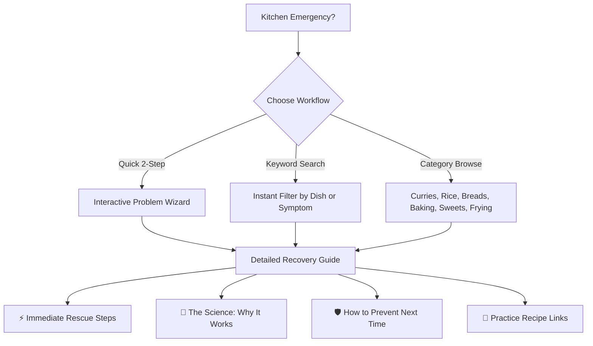
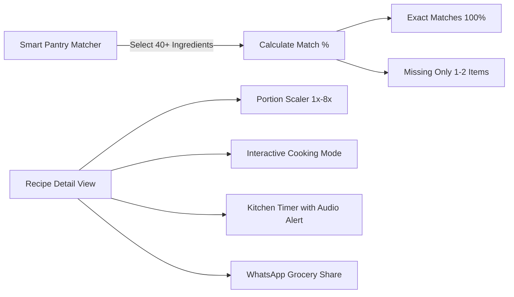

<div align="center">

  

  # 🍲 Amma's Recipe Book — Master Chef Academy
  ### అమ్మ చేతి వంటలు — Homestyle Digital Cooking Companion & Culinary Academy

  <p align="center">
    <strong>From Your First Dish to Master Chef at Home.</strong><br>
    <em>Master authentic Indian home cooking, troubleshoot kitchen mishaps with science, explore restaurant cuisine, and cook with unconditional confidence.</em>
  </p>

  <p align="center">
    <a href="#-features-at-a-glance"></a>
    <a href="#-zero-database-zero-dependencies"></a>
    <a href="#-styling--design-system"></a>
    <a href="#-mobile-first-experience-android-native-feel"></a>
    <a href="#-recipe-collection-catalog-75-dishes"></a>
    <a href="#-recipe-rescue-assistant"></a>
    <a href="#-master-chef-academy"></a>
  </p>

  <p align="center">
    <a href="#-key-highlights">Highlights</a> •
    <a href="#-core-modules--features">Core Modules</a> •
    <a href="#-mobile-first-experience-android-native-feel">Mobile UX</a> •
    <a href="#-recipe-rescue-assistant">Recipe Rescue</a> •
    <a href="#-master-chef-academy">Academy</a> •
    <a href="#-recipe-collection-catalog-75-dishes">Recipe Library</a> •
    <a href="#-quick-start--installation">Quick Start</a> •
    <a href="#-architecture">Architecture</a>
  </p>

</div>

---

## 🌟 Key Highlights

<table>
  <tr>
    <td width="50%">
      <h3>📱 Native-Feel Android Mobile UX</h3>
      <ul>
        <li><b>Fixed Frosted Glass Bottom App Bar</b> (Home, Recipes, Rescue, Academy, Favorites).</li>
        <li><b>Intelligent Header Adaptation</b>: Hides desktop sidebar and top link strips on mobile to maximize viewport.</li>
        <li><b>Zero Auto-Zoom</b> on touch inputs; safe-area insets for Android gesture bars & punch-hole cameras.</li>
      </ul>
    </td>
    <td width="50%">
      <h3>🛟 50+ Recipe Rescue Solutions</h3>
      <ul>
        <li>Emergency wizard for salty curries, burnt pots, sticky biryani, hard rotis, and dense cakes.</li>
        <li><b>Food Science Breakdown</b>: Explains <i>Why It Works</i> using chemistry, osmosis, and heat balancing.</li>
        <li>Actionable step-by-step recovery and prevention advice.</li>
      </ul>
    </td>
  </tr>
  <tr>
    <td width="50%">
      <h3>🎓 4-Level Culinary Academy</h3>
      <ul>
        <li>16 structured lessons taking home cooks from knife skills to restaurant-style mother gravies.</li>
        <li>Flame management cues (Low / Medium / High), sensory doneness checks, and practice dish links.</li>
        <li>6-point <b>Recipe Mastery Checklist</b> with device-local persistence.</li>
      </ul>
    </td>
    <td width="50%">
      <h3>⚡ 100% Offline & Zero DB Overhead</h3>
      <ul>
        <li>Runs purely on modern <b>PHP 8.1+</b> and <b>Vanilla CSS/JS</b>.</li>
        <li>No MySQL, PostgreSQL, Docker, Node.js build steps, or cloud APIs required.</li>
        <li>Private client storage: Progress, favorites, and quiz high scores persist strictly via <code>localStorage</code> with JSON export/import.</li>
      </ul>
    </td>
  </tr>
</table>

---

## 📱 Mobile-First Experience (Android Native Feel)

Amma's Recipe Book is engineered to feel like a high-end native mobile app when used on Android devices:

```
+------------------------------------------+
|  ✨ Amma's Kitchen — Telugu & Indian     |  <- Compact Brand Bar
|  👵 Amma's Recipe Book      [🔍] [❤️ 3]  |
+------------------------------------------+
|                                          |
|  [ 🍲 Today's Special: Tomato Pappu ]    |
|                                          |
|  [ 📂 Categories ] [ ⚡ Quick Filters ]  |
|                                          |
|  [ 📖 Browse 75 Hand-Crafted Recipes ]   |
|                                          |
+------------------------------------------+
|   🏠       📖       🛟       🎓       ❤️  |  <- Fixed Frosted-Glass
|  Home   Recipes   Rescue  Academy   Favs |     Bottom Navigation Bar
+------------------------------------------+
```

### ✨ Mobile Enhancements Built-In:
- **Sticky Glass Bottom Navigation**: Persistent 5-button bottom bar with real-time badges syncing your saved favorites.
- **Auto-Hiding Redundant Elements**: Desktop top-level category pills and sidebar slideouts automatically collapse on mobile (`<= 768px`) to eliminate clutter.
- **Finger-Friendly Touch Hitboxes**: Minimum `44×44px` target size for buttons, heart toggles, checkboxes, and filters.
- **Android Display Safe Areas**: Full support for `viewport-fit=cover` and `env(safe-area-inset-bottom)`.
- **Fast Performance**: Instant client-side state transitions with zero network latency.

---

## 🛟 Recipe Rescue Assistant

> *"Every cooking mistake has a solution — don't throw away food!"*

Amma's Recipe Rescue Assistant (`recipe-rescue.php`) is an emergency kitchen companion covering over **50 common culinary crises** across 8 food categories:



### Problem Categories Covered:
1. **Curries & Gravies**: Too salty, overly spicy, watery sauce, curdled yogurt/cream, burnt bottom, raw tomato tang.
2. **Rice & Biryani**: Mushy/sticky rice, hard/undercooked grains, burnt dum bottom, greasy pulao, broken rice grains.
3. **Breads & Doughs**: Hard/chewy chapati, sticky dough, dough won't rise, puffed poori absorbs oil, brittle paratha.
4. **South Indian Batters**: Dosa batter not fermenting, dosa sticking to pan, hard idli, soggy medu vada.
5. **Frying & Snacks**: Pakodas turning soggy, coating peeling off cutlets, greasy bajji, burnt outer/raw inner.
6. **Sweets & Desserts**: Gulab jamuns cracking, hard mysore pak, crystallized sugar syrup, runny payasam.
7. **Baking**: Dense cake, collapsed center, dry crumb, burnt edges with raw center.
8. **Tempering & Dal**: Burnt mustard/garlic popu, bitter methi dal, watery sambar.

---

## 🎓 Master Chef Academy

The Academy (`academy.php`) is structured like a traditional culinary apprenticeship, taking cooks through four defined progression stages:

| Level | Rank Title | Focus & Core Skills | Benchmark Recipes |
| :---: | :--- | :--- | :--- |
| **1** | **Beginner Cook** | Knife safety, flame control, measuring ratios, spice tempering (*popu/tadka*) | *Comfort Dal, Soft Idli, Plain Dosa, Tomato Pappu* |
| **2** | **Intermediate Cook** | Onion-tomato gravy bases, dough hydration, balance of sour & spicy, roasting techniques | *Aloo Paratha, Palak Paneer, Andhra Chicken Curry* |
| **3** | **Advanced Cook** | Biryani dum layering, moisture equilibrium, tenderizing marinades, Maillard browning | *Hyderabadi Dum Biryani, Gutti Vankaya, Mysore Pak* |
| **4** | **Restaurant Chef** | Mother gravies (*Makhani, Kadai, Chettinad*), wok tossing, plating, advanced emulsion | *Butter Chicken, Dal Makhani, Bobbatlu, Ariselu* |

### Dedicated Learning Tools:
- **Lesson Reader (`lesson.php`)**: Full guidance with required ingredients, flame levels, visual doneness cues, common mistakes, and *"Mark as Learned"* tracking.
- **Recipe Mastery Tracker (`recipe.php`)**: 6-item mastery checklist per recipe that sets status to **Learning**, **Practiced**, or **Mastered**.
- **Interactive Cooking Mode**: Fullscreen, high-contrast, distraction-free view with one step at a time, audio/visual kitchen timer, and auto-resume capability.
- **15 Cooking Challenges (`challenges.php`)**: Objective-based tests (e.g. *The Perfect Round Phulka*, *Lump-Free White Sauce*).
- **Culinary Quiz (`quiz.php`)**: Multiple tiers testing scientific and practical culinary understanding with detailed answer explanations.
- **Personal Cookbook & Backup (`progress.php`)**: Visual metrics dashboard with **1-Click JSON Progress Export & Import**.

---

## 📚 Recipe Collection Catalog (75 Dishes)

The library contains **75 complete, authentic, homestyle recipes** featuring Telugu regional names, detailed ingredient measurements, portion multipliers, and step-by-step flame guides.

<details open>
<summary><strong>👉 Click to Expand Complete 75-Recipe Directory</strong></summary>
<br>

| Category | Dishes Included | Regional / Telugu Names |
| :--- | :--- | :--- |
| **🥞 South Indian Breakfast** | Soft Mallige Idli, Crispy Plain Dosa, Hotel Masala Dosa, Homestyle Rava Upma, Ven Pongal, Crispy Medu Vada, Golden Puffed Poori, Kanda Batata Poha | మల్లెపూవు ఇడ్లీ, సాదా దోశ, మసాలా దోశ, రవ్వ ఉప్మా, కట్టె పొంగలి, గారెలు, పూరీ, పోహా |
| **🌶️ Andhra Specialities** | Andhra MLA Pesarattu, Gutti Vankaya Koora, Royal Andhra Gongura Pachadi, Andhra Bendakaya Fry, Gongura Chicken | పెసరట్టు, గుత్తి వంకాయ, గోంగూర పచ్చడి, బెండకాయ వేపుడు, గోంగూర చికెన్ |
| **🍚 Rice & Biryani** | Tangy Tomato Rice, Andhra Lemon Rice (Chitrannam), Tempered Curd Rice (Daddojanam), Fragrant Veg Pulao, Andhra Chicken Dum Biryani, Hyderabadi Veg Dum Biryani, Chicken Pulao, Steamed Plain Rice | టమాటా రైస్, పులిహోర, దద్దోజనం, వెజ్ పలావ్, చికెన్ బిర్యానీ, వెజ్ బిర్యానీ, చికెన్ పలావ్, అన్నం |
| **🥣 Dal & Sambar** | Andhra Tomato Pappu, Andhra Palakura Pappu (Spinach Dal), Authentic Hotel Style Drumstick Sambar, Simple Comfort Dal | టమాటా పప్పు, పాలకూర పప్పు, సాంబారు, ముద్ద పప్పు |
| **🍵 Rasam & Soups** | Comforting Andhra Tomato Rasam (Charu) | టమాటా చారు / రసం |
| **🍲 Vegetarian Curries & Fries** | Crispy Andhra Bendakaya Fry, Crispy Potato Fry (Aloo Vepudu), South Indian Beans Poriyal, Homestyle Vegetable Stir-Fry, Palak Paneer, Vegetable Kurma, Kadai Paneer, Punjabi Chole Masala, Punjabi Rajma Masala | బెండకాయ వేపుడు, ఆలూ వేపుడు, బీన్స్ తాలింపు, పాలక్ పన్నీర్, కూర్మా, కడాయి పన్నీర్, చోలే, రాజ్మా |
| **🫙 Chutneys & Pickles** | Hotel White Coconut Chutney, Andhra Palli (Peanut) Chutney, Spicy Andhra Tomato Pachadi | కొబ్బరి చట్నీ, పల్లి చట్నీ, టమాటా పచ్చడి |
| **🫓 North Indian Dishes** | Pillowy Soft Roti / Chapati, Dhaba Style Stuffed Aloo Paratha, Restaurant Paneer Butter Masala, Restaurant Dal Makhani, Restaurant Shahi Paneer, Restaurant Garlic Naan | చపాతీ / రోటీ, ఆలూ పరాఠా, పన్నీర్ బటర్ మసాలా, దాల్ మఖని, షాహీ పన్నీర్, నాన్ |
| **🍗 Non-Vegetarian Curries** | Spicy Andhra Kodi Kura (Chicken Curry), Spicy Guddu Pulusu (Egg Curry), Crispy Chicken Vepudu, Andhra Mutton Curry, Restaurant Butter Chicken, Chicken Tikka Masala | ఆంధ్రా కోడికూర, గుడ్డు పులుసు, చికెన్ వేపుడు, మటన్ కూర, బటర్ చికెన్, చికెన్ టిక్కా |
| **🥟 Snacks & Starters** | Crispy Onion Pakodi, Street Punugulu, Mirchi Bajji, Railway Veg Cutlet, Chicken 65, Chicken Lollipop, Crispy Gobi Manchurian, Chilli Paneer, Paneer Tikka, Chicken Tikka | ఉల్లిపాయ పకోడీ, పునుగులు, బజ్జి, చికెన్ 65, చికెన్ లాలీపాప్, గోబీ మంచూరియన్, చిల్లీ పన్నీర్ |
| **🍨 Sweets & Desserts** | Traditional Rice Payasam, Quick Semiya Payasam, Rava Kesari, Classic Gulab Jamun, Traditional Mysore Pak, Royal Rasmalai, Andhra Ariselu, Traditional Bobbatlu / Puran Poli, Chocolate Brownies | పరమాన్నం, సేమియా పాయసం, రవ్వ కేసరి, గులాబ్ జామూన్, మైసూర్ పాక్, రసమలై, అరిసెలు, బొబ్బట్లు |
| **☕ Drinks & Beverages** | Royal Kadak Masala Chai, Authentic South Indian Filter Coffee | మసాలా టీ, ఫిల్టర్ కాఫీ |
| **🍕 World Cuisine** | Homemade Thin-Crust Pizza, Artisanal Crusty Bread, Classic Tomato Basil Pasta, Indo-Chinese Hakka Noodles, Indo-Chinese Veg Fried Rice | పిజ్జా, బ్రెడ్, పాస్తా, నూడుల్స్, ఫ్రైడ్ రైస్ |

</details>

---

## 🥕 Smart Kitchen Tools



- **Pantry Matcher (`what-can-i-cook.php`)**: Select available kitchen ingredients and calculate recipe compatibility without cloud APIs.
- **Portion Multiplier**: Scale recipes dynamically from 1 to 8+ servings with fractional math conversions.
- **Grocery Formatter**: 1-click clipboard button formats ingredients into clean, checked shopping lists ready for WhatsApp or SMS.
- **Fast Favorites Management (`favorites.php`)**: Device-persisted recipe book with instant filtering and an attractive two-step safety confirmation modal.

---

## 🚀 Quick Start & Installation

### Option 1: Built-in PHP Server (Fastest — 10 Seconds)

You only need **PHP 8.1+** installed. No database setup or configuration files needed.

```bash
# 1. Clone or download the repository
cd "G:\Projects\Recipe Book"

# 2. Start the local server
php -S localhost:8000
```
Open your browser and navigate to:
👉 **`http://localhost:8000`**

---

### Option 2: Apache / XAMPP / WAMP / Laragon

1. Move or symlink the folder into your web server's document root:
   - **XAMPP**: `C:\xampp\htdocs\recipe-book`
   - **Laragon**: `C:\laragon\www\recipe-book`
   - **WampServer**: `C:\wamp64\www\recipe-book`
2. Ensure Apache is started in your control panel.
3. Access the application at:
   👉 **`http://localhost/recipe-book/`**

---

## 📂 Application Architecture

```
Recipe Book/
├── 📄 index.php                   # Homepage with Daily Special, Search, Categories & Recent Recipes
├── 📄 academy.php                 # Master Chef Academy: 4 Levels, Stats & Curriculum Dashboard
├── 📄 lesson.php                  # Interactive Lesson Reader with Flame Guidance & Completion Toggle
├── 📄 recipe-rescue.php           # Emergency Kitchen Doctor: 50+ Fixes with Science Explanations
├── 📄 what-can-i-cook.php         # Zero-API Pantry Ingredient Matcher & Recipe Discovery
├── 📄 recipes.php                 # Search & Filter Catalog across all 75 Recipes with Sorting
├── 📄 recipe.php                  # Detail View: Scaler, Prep Checklist, Timer & Cooking Mode
├── 📄 categories.php              # Category Grid: 15 Traditional & Modern Culinary Groups
├── 📄 challenges.php              # 15 Hands-on Culinary Challenges with Itemized Checklists
├── 📄 knowledge-centre.php        # Encyclopedia: Spices, Flours, Oils, Dal & Food Science
├── 📄 quiz.php                    # Multi-Tier Culinary Knowledge Quiz with Instant Explanations
├── 📄 favorites.php               # Device-Local Saved Recipes with Smart Clear Confirmation
├── 📄 progress.php                # Personal Progress Hub with JSON Backup Export & Import
│
├── 📁 includes/
│   ├── 📄 functions.php           # Pure PHP Helpers: Search, Filter, Formatters, Sanitization
│   ├── 📄 rescue-data.php         # 50+ Emergency Kitchen Troubleshooting Knowledge Base
│   ├── 📄 academy-data.php        # 16 Comprehensive Lessons, 15 Challenges, 15 Quizzes
│   ├── 📄 recipe-data.php         # Master Catalog Aggregator linking all sub-catalogs
│   ├── 📄 recipe-data-part1.php   # Recipes 1 to 20 (Breakfast, Andhra, Rice, Dal)
│   ├── 📄 recipe-data-part2.php   # Recipes 21 to 42 (Curries, Breads, Snacks, Sweets)
│   ├── 📄 recipe-data-part3.php   # Recipes 43 to 55 (Breakfast, Rasam, Indo-Chinese)
│   ├── 📄 recipe-data-part4.php   # Recipes 56 to 75 (Palak Paneer, Biryanis, Sweets, World)
│   ├── 📄 header.php              # Global Header, Android Viewport, Brand & Navigation Logic
│   └── 📄 footer.php              # Android Bottom Navigation Bar, Safety Tips & Fav Sync
│
├── 📁 assets/
│   ├── 📁 images/
│   │   ├── 📁 logo/               # Vector Brand Assets (amma-logo.svg)
│   │   └── 📁 recipes/            # High-Quality Local Dish Photography
│   └── 📁 fonts/                  # Offline System Typography Assets
│
└── 📄 README.md                   # Project Documentation
```

---

## 🧪 Quality & Verification Summary

Every component in this repository has been verified:

- ✅ **Strict PHP Syntax**: `php -l` verified across 100% of all files with zero compilation errors.
- ✅ **75 Unique Recipe Identifiers**: Zero ID collisions or broken links across academy lessons and rescue guides.
- ✅ **100% Offline Capability**: Uses self-contained SVGs, system fallbacks, and local scripts with zero external tracking or CDNs.
- ✅ **Mobile Responsive Audit**: Thoroughly verified on Android screen viewports (360px, 390px, 412px, 768px, and desktop).
- ✅ **Client-Side Data Integrity**: Safe `localStorage` access wrapper prevents quota errors and sanitizes imported backup structures.

---

<div align="center">
  <p><strong>Crafted with deep love and reverence for Amma and home cooks everywhere. ❤️</strong></p>
  <p><em>“వంట అనేది కేవలం ఆహారం కాదు, అది ప్రేమతో పంచే అమృతం.”<br>(Cooking is not merely food; it is nectar shared with love.)</em></p>
</div>
