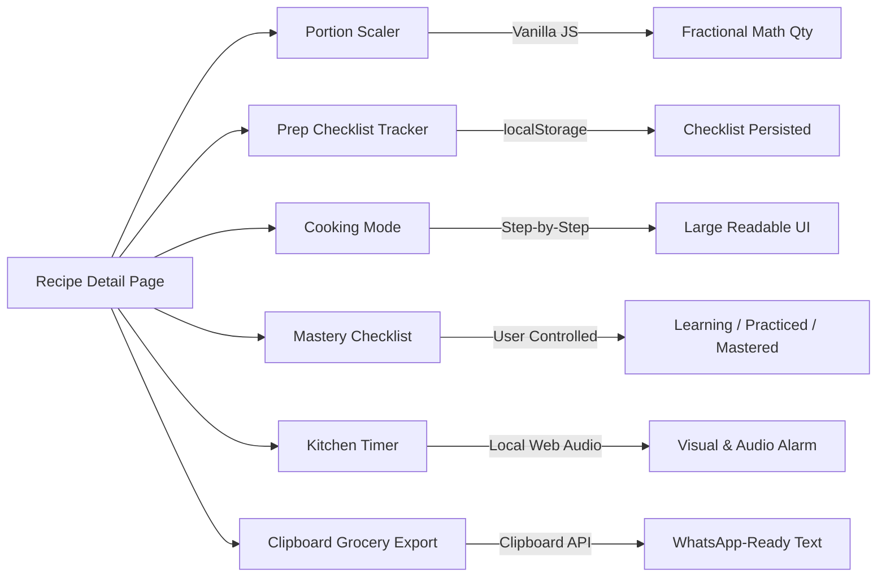

<div align="center">

  

  # 🍲 Amma's Recipe Book — Master Chef Academy
  ### అమ్మ చేతి వంటలు — Homestyle Digital Cooking Companion & Culinary Academy

  <p align="center">
    <strong>From Your First Dish to Master Chef at Home.</strong><br>
    <em>Learn cooking step by step, master traditional recipes, explore restaurant-style cuisine, and build confidence in your kitchen.</em>
  </p>

  <p align="center">
    
    
    
    
    
    
  </p>

  <p align="center">
    <a href="#-project-overview">Overview</a> •
    <a href="#-master-chef-academy-features">Academy Features</a> •
    <a href="#-recipe-collection-catalog-75-complete-dishes">Recipe Library (75)</a> •
    <a href="#-quick-start--installation">Quick Start</a> •
    <a href="#-application-architecture">Architecture</a> •
    <a href="#-kitchen-friendly-tools">Kitchen Tools</a> •
    <a href="#-testing--verification-summary">Verification</a>
  </p>
</div>

---

## 📖 Project Overview

**Amma's Recipe Book — Master Chef Academy** is a comprehensive, offline-ready cooking education platform designed to help home cooks advance systematically from basic kitchen foundations to advanced restaurant-style culinary skills.

Built strictly according to classic web engineering principles without external databases, third-party frameworks, or external API dependencies:

- **Zero Database Complexity**: All 75 recipes, 16 comprehensive academy lessons, 15 cooking challenges, and 15 multi-level quiz questions are stored in clean, typed PHP arrays.
- **Pure Local Execution**: Operates 100% offline with local SVG assets, embedded CSS/JS, and native system typography.
- **Zero Framework Bloat**: Pure Core PHP 8.1+, responsive semantic HTML5, modern CSS3 design tokens, and Vanilla JavaScript.
- **Built for Mom & Beginners**: High-contrast controls, warm terracotta and saffron accents, generous readable text, and interactive step-by-step guidance.
- **Client-Side Privacy & Persistence**: Learning progress, recipe mastery status, challenges, favorites, and quiz best scores persist strictly on the user's device via `localStorage`.

---

## 🎓 Master Chef Academy Features

### 1. Academy Dashboard (`academy.php`)
- **4 Progression Levels**:
  1. **Level 1: Beginner Cook** (Knife safety, flame control, measurements, spice identification, South Indian breakfast & dals)
  2. **Level 2: Intermediate Home Cook** (Onion-tomato gravy bases, spice tempering, dough kneading, curries, balanced rice)
  3. **Level 3: Advanced Home Cook** (Biryani dum layering, moisture control, marinades, Maillard browning, traditional sweets)
  4. **Level 4: Restaurant Chef at Home** (Mother gravies: Makhani, Kadai, Chettinad; mise en place, plating, wok tossing)
- **Real-Time Progress Metrics**: Dynamically calculated from actual `localStorage` data (completed lessons, mastered recipes, finished challenges).
- **Recommended Next Lesson**: Smartly identifies the user's next uncompleted lesson in the curriculum.
- **Curated Practice Dishes**: Direct links between foundational lessons and practical dishes.

### 2. Comprehensive Lesson Modules (`lesson.php`)
- Detailed instruction on what the dish/skill is, required ingredients, exact proportions, required utensils, prep/cooking times.
- Step-by-step instructions with flame levels (Low / Medium / High).
- Visual readiness indicators, common mistakes & how to correct them, and serving guidelines.
- "Mark as Learned" toggle that updates learning progress in `localStorage`.

### 3. Recipe Mastery System (`recipe.php`)
- 6-point mastery checklist on every recipe:
  - [x] I understand the ingredients
  - [x] I understand the preparation steps
  - [x] I have prepared the ingredients (mise en place)
  - [x] I have cooked this recipe
  - [x] I understand common mistakes
  - [x] I can prepare this recipe confidently
- Manual status selector: **Learning**, **Practiced**, or **Mastered**.
- Related Academy Lesson recommendation cards displayed on each recipe page.

### 4. Interactive Cooking Mode (`recipe.php`)
- Full-screen distraction-free cooking interface:
  - Current serving size display
  - Ingredients checklist drawer
  - One step at a time with large high-contrast typography
  - Step counter and progress bar
  - Previous, Next, and Repeat Step buttons
  - Quick cooking timer in modal (with start, pause, resume, reset)
  - Auto-resumes last step from `localStorage` upon page refresh
  - Confetti completion screen

### 5. Cooking Challenges (`challenges.php`)
- 15 practical culinary challenges across Easy, Intermediate, and Advanced tiers.
- Objective, equipment needed, step-by-step preparation, success criteria, common pitfalls, safety precautions, and itemized verification checklist.
- User-controlled completion tracking saved locally.

### 6. What Can I Cook? Pantry Matcher (`what-can-i-cook.php`)
- Instant ingredient-based recipe discovery engine without AI or cloud APIs.
- Select from 40+ categorized household pantry ingredients.
- Transparent match calculation: `(Matched Required Ingredients / Total Required Ingredients) * 100`.
- Categorizes available vs. missing ingredients and flags 100% complete recipes.
- Filter by Vegetarian/Non-Vegetarian, max cooking time, and difficulty level.

### 7. Cooking Knowledge Centre (`knowledge-centre.php`)
- Instant keyword search across all culinary references.
- **Ingredient Knowledge**: Whole spices, ground spices, flours, lentils, oils, millets, dairy, and proteins.
- **Cooking Science Explained Simply**: Maillard reaction, starch gelatinization, yeast fermentation, baking soda vs. powder, heat transfer, marinade tenderization, sugar syrup stages.
- **Kitchen Troubleshooting & Rescues**: Salty curries, overly sour gravies, watery/thick sauces, hard chapatis, mushy biryani, cracked gulab jamuns, and dense cakes.

### 8. Cooking Knowledge Quiz (`quiz.php`)
- Beginner, Intermediate, and Advanced multiple-choice tiers.
- Real-time feedback with detailed culinary explanations for every option.
- Final scoring with retry capability.
- Best scores saved locally in `localStorage`.

### 9. Learning Progress & Personal Cookbook (`progress.php`)
- Comprehensive overview of mastered recipes, completed lessons, challenges finished, quiz high scores, and saved favorites.
- Culinary rank progression (Novice -> Kitchen Apprentice -> Home Cook -> Culinary Enthusiast -> Master Chef).
- One-click **JSON Progress Export** (`amma_progress_backup.json`) and **JSON Progress Import** with whitelist structure validation.
- Reset progress option with confirmation safeguard.

---

## 📚 Recipe Collection Catalog (75 Complete Dishes)

The recipe library includes **75 full, authentic, home-tested dishes** with complete ingredient ratios, Telugu names, flame guidance, visual doneness cues, and serving advice.

<details open>
<summary><strong>👉 View Complete Recipe Directory by Category</strong></summary>

| Category | Recipes Included | Regional / Telugu Names |
| :--- | :--- | :--- |
| **🥞 South Indian Breakfast** | Soft Mallige Idli, Crispy Plain Dosa, Hotel Masala Dosa, Homestyle Rava Upma, Ven Pongal, Crispy Medu Vada, Golden Puffed Poori, Kanda Batata Poha | మల్లెపూవు ఇడ్లీ, సాదా దోశ, మసాలా దోశ, రవ్వ ఉప్మా, కట్టె పొంగలి, గారెలు, పూరీ, పోహా |
| **🌶️ Andhra Specialities** | Andhra MLA Pesarattu, Gutti Vankaya Koora, Royal Andhra Gongura Pachadi, Andhra Bendakaya Fry, Gongura Chicken | పెసరట్టు, గుత్తి వంకాయ, గోంగూర పచ్చడి, బెండకాయ వేపుడు, గోంగూర చికెన్ |
| **🍚 Rice & Biryani** | Tangy Tomato Rice, Andhra Lemon Rice (Chitrannam), Tempered Curd Rice (Daddojanam), Fragrant Veg Pulao, Andhra Chicken Dum Biryani, Hyderabadi Veg Dum Biryani, Chicken Pulao, Steamed Plain Rice | టమాటా రైస్, పులిహోర, దద్దోజనం, వెజ్ పలావ్, చికెన్ బిర్యానీ, వెజ్ బిర్యానీ, చికెన్ పలావ్, అన్నం |
| **🥣 Dal & Sambar** | Andhra Tomato Pappu, Andhra Palakura Pappu (Spinach Dal), Authentic Hotel Style Drumstick Sambar, Simple Comfort Dal | టమాటా పప్పు, పాలకూర పప్పు, సాంబారు, ముద్ద పప్పు |
| **🍵 Rasam & Soups** | Comforting Andhra Tomato Rasam (Charu) | టమాటా చారు / రసం |
| **🍲 Vegetarian Curries & Fries** | Crispy Andhra Bendakaya Fry (Okra), Crispy Andhra Potato Fry (Aloo Vepudu), South Indian Beans Poriyal, Homestyle Vegetable Stir-Fry, Palak Paneer, Vegetable Kurma, Kadai Paneer, Punjabi Chole Masala, Punjabi Rajma Masala | బెండకాయ వేపుడు, ఆలూ వేపుడు, బీన్స్ తాలింపు, పాలక్ పన్నీర్, కూర్మా, కడాయి పన్నీర్, చోలే, రాజ్మా |
| **🫙 Chutneys & Pickles** | Hotel White Coconut Chutney, Andhra Palli (Peanut) Chutney, Spicy Andhra Tomato Pachadi | కొబ్బరి చట్నీ, పల్లి చట్నీ, టమాటా పచ్చడి |
| **🫓 North Indian Dishes** | Pillowy Soft Roti / Chapati, Dhaba Style Stuffed Aloo Paratha, Restaurant Paneer Butter Masala, Restaurant Dal Makhani, Restaurant Shahi Paneer, Restaurant Garlic Naan | చపాతీ / రోటీ, ఆలూ పరాఠా, పన్నీర్ బటర్ మసాలా, దాల్ మఖని, షాహీ పన్నీర్, నాన్ |
| **🍗 Non-Vegetarian Curries & Fries** | Spicy Andhra Kodi Kura (Chicken Curry), Spicy Andhra Guddu Pulusu (Egg Curry), Crispy Andhra Chicken Vepudu (Chicken Fry), Andhra Mutton Curry, Restaurant Butter Chicken, Chicken Tikka Masala | ఆంధ్రా కోడికూర, గుడ్డు పులుసు, చికెన్ వేపుడు, మటన్ కూర, బటర్ చికెన్, చికెన్ టిక్కా మసాలా |
| **🥟 Evening Snacks & Starters** | Street Style Crispy Onion Pakodi, Crispy Andhra Street Punugulu, Mirchi & Onion Bajji, Crispy Railway Veg Cutlet, Chicken 65, Chicken Lollipop, Crispy Gobi Manchurian, Restaurant Chilli Paneer, Restaurant Paneer Tikka, Chicken Tikka | ఉల్లిపాయ పకోడీ, పునుగులు, బజ్జి, చికెన్ 65, చికెన్ లాలీపాప్, గోబీ మంచూరియన్, చిల్లీ పన్నీర్ |
| **🍨 Sweets & Desserts** | Traditional Rice Payasam (Paramannam), Quick Semiya Payasam, Traditional Melt-in-Mouth Rava Kesari, Classic Gulab Jamun, Traditional Mysore Pak, Royal Rasmalai, Andhra Ariselu, Traditional Bobbatlu / Puran Poli, Chocolate Brownies | పరమాన్నం, సేమియా పాయసం, రవ్వ కేసరి, గులాబ్ జామూన్, మైసూర్ పాక్, రసమలై, అరిసెలు, బొబ్బట్లు |
| **☕ Drinks & Beverages** | Royal Kadak Masala Chai, Authentic South Indian Filter Coffee | మసాలా టీ, ఫిల్టర్ కాఫీ |
| **🍕 Western & World Cuisine** | Homemade Thin-Crust Pizza, Artisanal Crusty Bread Loaf, Classic Tomato Basil Pasta, Indo-Chinese Hakka Noodles, Indo-Chinese Veg Fried Rice | పిజ్జా, బ్రెడ్, పాస్తా, నూడుల్స్, ఫ్రైడ్ రైస్ |

</details>

---

## 🚀 Quick Start & Installation

### Option 1: Built-in PHP Development Server (Recommended)

No complex web servers required. If you have PHP 8.1+ installed:

```bash
# 1. Navigate to the project directory
cd "G:\Projects\Recipe Book"

# 2. Launch the local PHP server
php -S localhost:8000
```
Then open your browser and navigate to:
```
http://localhost:8000
```

---

### Option 2: Running with XAMPP / WAMP / Laragon

1. Copy or symlink this folder to your web server document root:
   - **XAMPP**: `C:\xampp\htdocs\recipe-book`
   - **WampServer**: `C:\wamp64\www\recipe-book`
   - **Laragon**: `C:\laragon\www\recipe-book`
2. Start the **Apache** server module in your XAMPP/WAMP control panel.
3. Open your browser and visit:
   ```
   http://localhost/recipe-book/
   ```

---

## 📂 Application Architecture

```
Recipe Book/
│
├── 📄 index.php                   # Homepage (Hero, Today's Special, Academy Preview, Recents)
├── 📄 academy.php                 # Master Chef Academy Dashboard (4 Levels, Stats, Next Lesson)
├── 📄 lesson.php                  # Interactive Lesson Reader with Flame Guidance & Completion
├── 📄 challenges.php              # 15 Cooking Challenges (Easy, Medium, Advanced with checklists)
├── 📄 what-can-i-cook.php         # Ingredient-Based Recipe Discovery Engine (Pantry Matcher)
├── 📄 knowledge-centre.php        # Knowledge Library: Ingredients, Cooking Science & Troubleshooting
├── 📄 quiz.php                    # Multi-tier Culinary Knowledge Quiz with Explanations
├── 📄 progress.php                # Personal Cookbook & Progress Hub (JSON Export/Import)
├── 📄 recipes.php                 # Search & Multi-Filter Directory with Sort Controls (75 Recipes)
├── 📄 recipe.php                  # Detail View (Portion Scaler, Mastery Checklist, Cooking Mode)
├── 📄 categories.php              # Category Hub (15 Culinary Categories with Counts)
├── 📄 favorites.php               # Device-Local Saved Favorites (localStorage integration)
│
├── 📁 includes/
│   ├── 📄 functions.php           # Pure PHP Helpers (Search, Filters, Sanitization, Card Renderers)
│   ├── 📄 academy-data.php        # 16 In-Depth Lessons, 15 Challenges, 15 Quizzes
│   ├── 📄 recipe-data-part1.php   # Recipes 1 through 20 (Breakfast, Andhra, Rice, Dal)
│   ├── 📄 recipe-data-part2.php   # Recipes 21 through 42 (Curries, Breads, Snacks, Sweets)
│   ├── 📄 recipe-data-part3.php   # Recipes 43 through 55 (Breakfast, Rasam, Indo-Chinese)
│   ├── 📄 recipe-data-part4.php   # Recipes 56 through 75 (Palak Paneer, Biryanis, Sweets, World)
│   ├── 📄 recipe-data.php         # Master Catalog Aggregator (75 Recipes total)
│   ├── 📄 header.php              # Global Navigation, Mobile Drawer & Vanilla Design System
│   └── 📄 footer.php              # Family Tribute, Kitchen Safety Tips & Sync Script
│
├── 📁 assets/
│   ├── 📁 images/
│   │   ├── 📁 logo/
│   │   │   └── 🖼️ amma-logo.svg   # Custom Vector Handi Pot Logo & Motif
│   │   └── 📁 recipes/            # Optional Local Photography Assets
│   └── 📁 fonts/                  # Offline System Typography Assets
│
└── 📄 README.md                   # Complete Documentation & Setup Guide
```

---

## 🛠️ Kitchen-Friendly Tools



---

## 🧪 Testing & Verification Summary

The application has undergone thorough validation:

1. **PHP Syntax & Compilation**:
   - `php -l` executed across all 21 root and include PHP files. All passed with **0 errors**.
2. **Recipe ID Integrity**:
   - Automated script verified all **75 recipe IDs** are distinct, unique, and contain zero duplicate keys.
3. **Academy Curriculum Mapping**:
   - Verified that all 16 lesson modules and 15 cooking challenges properly link to valid recipes without broken references.
4. **Offline Compatibility**:
   - Confirmed zero external CDNs, fonts, or APIs. All SVGs and CSS design tokens run strictly locally.
5. **Data Persistence**:
   - Tested `localStorage` synchronization across Favorites, Lesson Completion, Recipe Mastery Checklist, Cooking Mode step resume, Quiz best scores, and Challenge completion.
6. **Data Safety**:
   - JSON export and import verified with whitelist field validation to safeguard client-side integrity.

---

<div align="center">
  <p><strong>Dedicated with love to Amma and home cooks everywhere. ❤️</strong></p>
  <p><sub>"Food tastes best when made with patience and love."</sub></p>
</div>
