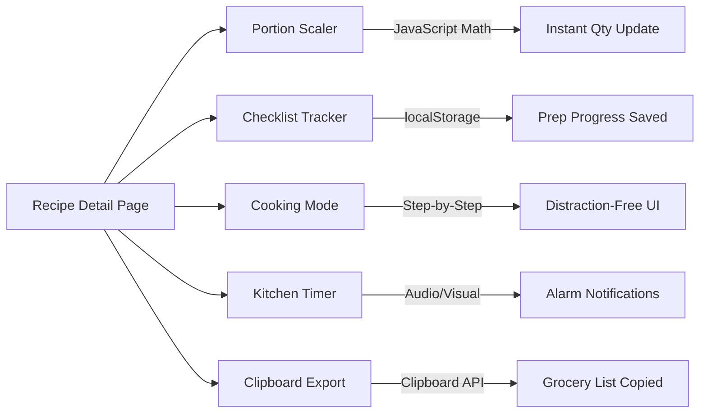

<div align="center">

  

  # 🍲 Amma's Recipe Book
  ### అమ్మ చేతి వంటలు — Homestyle Digital Cooking Companion

  <p align="center">
    <strong>A handcrafted, warm, and loving family recipe application built for Amma.</strong><br>
    <em>Simple ingredients. Clear steps. Authentic Indian taste. 100% offline-ready.</em>
  </p>

  <p align="center">
    
    
    
    
    
  </p>

  <p align="center">
    <a href="#-project-overview">Overview</a> •
    <a href="#-key-features">Features</a> •
    <a href="#-recipe-collection-catalog">Recipe Library</a> •
    <a href="#-quick-start--installation">Quick Start</a> •
    <a href="#-application-architecture">Architecture</a> •
    <a href="#-kitchen-friendly-tools">Kitchen Tools</a> •
    <a href="#-security--design-principles">Design Principles</a>
  </p>
</div>

---

## 📖 Project Overview

**Amma's Recipe Book** is designed specifically as a thoughtful, accessible, and intuitive digital cooking companion for mothers and home cooks. Cooking should be joyful and stress-free—this web application eliminates confusion over ingredient quantities, heat levels, step order, and cooking techniques.

Built strictly according to classic web engineering principles without the bloat of external databases, third-party frameworks, or external API dependencies:

- **Zero Database Complexity**: All 42 recipes are stored in clean, typed PHP arrays.
- **Pure Local Execution**: Operates completely offline with local SVG assets and native system typography.
- **Zero Framework Bloat**: Pure Core PHP 8.1+, responsive semantic HTML5, modern CSS3 design tokens, and Vanilla JavaScript.
- **Built for Mom**: High-contrast buttons, warm terracotta and saffron accents, generous text sizing, and distraction-free cooking modes.

---

## ✨ Key Features

<table>
  <tr>
    <td width="50%">
      <h3>👨‍🍳 Distraction-Free Cooking Mode</h3>
      Step-by-step full-screen cooking view showing one instruction at a time in large, readable typography with a live progress bar, previous/next controls, and celebratory completion screen.
    </td>
    <td width="50%">
      <h3>⚖️ Dynamic Portion Scaler</h3>
      Adjust portion sizes up or down with a single tap. Ingredient quantities recalculate instantly using fractional math (¼, ½, ¾, 1½) without modifying original recipe data.
    </td>
  </tr>
  <tr>
    <td width="50%">
      <h3>📋 Interactive Prep Checklist</h3>
      Check off ingredients as you gather them from the pantry. Checked items and progress persist locally on the device using <code>localStorage</code>.
    </td>
    <td width="50%">
      <h3>⏱️ In-Kitchen Countdown Timer</h3>
      Built-in cooking timer with quick presets (3 mins, 5 mins, 10 mins) and audible visual alarm notifications that work completely offline without third-party services.
    </td>
  </tr>
  <tr>
    <td width="50%">
      <h3>🔍 Deep Search & Multi-Filter</h3>
      Search across dish names, Telugu regional names, ingredients, or cuisines. Filter by Vegetarian / Non-Vegetarian, total time (&lt;30m), and difficulty level.
    </td>
    <td width="50%">
      <h3>❤️ Device-Local Favorites & History</h3>
      Bookmark loved recipes using the heart icon and access them from the dedicated Favorites tab. Automatically tracks recently viewed dishes on the homepage.
    </td>
  </tr>
</table>

---

## 📚 Recipe Collection Catalog (42 Complete Dishes)

The starter collection includes **42 full, authentic, home-tested dishes** with complete ingredient ratios, Telugu names, flame guidance, visual doneness cues, and serving advice.

<details open>
<summary><strong>👉 View Complete Recipe Directory by Category</strong></summary>

| Category | Recipes Included | Regional / Telugu Names |
| :--- | :--- | :--- |
| **🥞 South Indian Breakfast** | Soft Mallige Idli, Crispy Plain Dosa, Hotel Masala Dosa, Homestyle Rava Upma, Ven Pongal, Crispy Medu Vada, Golden Puffed Poori | మల్లెపూవు ఇడ్లీ, సాదా దోశ, మసాలా దోశ, రవ్వ ఉప్మా, కట్టె పొంగలి, గారెలు, పూరీ |
| **🌶️ Andhra Specialities** | Andhra MLA Pesarattu, Gutti Vankaya Koora, Royal Andhra Gongura Pachadi | పెసరట్టు, గుత్తి వంకాయ, గోంగూర పచ్చడి |
| **🍚 Rice & Biryani** | Tangy Tomato Rice, Andhra Lemon Rice (Chitrannam), Tempered Curd Rice (Daddojanam), Fragrant Veg Pulao, Andhra Chicken Dum Biryani, Hyderabadi Veg Dum Biryani | టమాటా రైస్, నిమ్మకాయ పులిహోర, దద్దోజనం, వెజ్ పలావ్, చికెన్ బిర్యానీ, వెజ్ బిర్యానీ |
| **🥣 Dal & Sambar** | Andhra Tomato Pappu, Andhra Palakura Pappu (Spinach Dal), Authentic Hotel Style Drumstick Sambar | టమాటా పప్పు, పాలకూర పప్పు, మునక్కాయ సాంబారు |
| **🍵 Rasam & Soups** | Comforting Andhra Tomato Rasam (Charu) | టమాటా చారు / రసం |
| **🍲 Vegetarian Curries & Fries** | Crispy Andhra Bendakaya Fry (Okra), Crispy Andhra Potato Fry (Aloo Vepudu), South Indian Beans Poriyal | బెండకాయ వేపుడు, బంగాళాదుంప వేపుడు, బీన్స్ తాలింపు |
| **🫙 Chutneys & Pickles** | Hotel White Coconut Chutney, Andhra Palli (Peanut) Chutney, Spicy Andhra Tomato Pachadi | కొబ్బరి చట్నీ, పల్లి చట్నీ, టమాటా పచ్చడి |
| **🫓 North Indian Dishes** | Pillowy Soft Roti / Chapati, Dhaba Style Stuffed Aloo Paratha, Restaurant Paneer Butter Masala | చపాతీ / రోటీ, ఆలూ పరాఠా, పన్నీర్ బటర్ మసాలా |
| **🍗 Non-Vegetarian Curries & Fries** | Spicy Andhra Kodi Kura (Chicken Curry), Spicy Andhra Guddu Pulusu (Egg Curry), Crispy Andhra Chicken Vepudu (Chicken Fry) | ఆంధ్రా కోడికూర, గుడ్డు పులుసు, ఆంధ్రా చికెన్ వేపుడు |
| **🥟 Evening Snacks** | Street Style Crispy Onion Pakodi, Crispy Andhra Street Punugulu, Mirchi & Onion Bajji, Crispy Railway Veg Cutlet | ఉల్లిపాయ పకోడీ, పునుగులు, ఉల్లిపాయ బజ్జి, వెజ్ కట్లెట్ |
| **🍨 Sweets & Desserts** | Traditional Rice Payasam (Paramannam), Quick Semiya Payasam, Traditional Melt-in-Mouth Rava Kesari, Classic Gulab Jamun | పరమాన్నం, సేమియా పాయసం, రవ్వ కేసరి, గులాబ్ జామూన్ |
| **☕ Drinks & Beverages** | Royal Kadak Masala Chai | మసాలా టీ (Masala Tea) |

</details>

---

## 🚀 Quick Start & Installation

### Option 1: Built-in PHP Development Server (Recommended)

No complex web servers required. If you have PHP 8.1+ installed:

```bash
# 1. Navigate to the project directory
cd "G:\Projects\Recipe Book"

# 2. Launch the local PHP server
php -S localhost:8000
```
Then open your browser and navigate to:
```
http://localhost:8000
```

---

### Option 2: Running with XAMPP / WAMP / Laragon

1. Copy or symlink this folder to your web server document root:
   - **XAMPP**: `C:\xampp\htdocs\recipe-book`
   - **WampServer**: `C:\wamp64\www\recipe-book`
   - **Laragon**: `C:\laragon\www\recipe-book`
2. Start the **Apache** server module in your XAMPP/WAMP control panel.
3. Open your browser and visit:
   ```
   http://localhost/recipe-book/
   ```

---

## 📂 Application Architecture

```
Recipe Book/
│
├── 📄 index.php                   # Homepage (Hero, Today's Special, Categories, Recents)
├── 📄 recipes.php                 # Search & Multi-Filter Directory with Sort Controls
├── 📄 recipe.php                  # Detail View (Portion Scaler, Cooking Mode, Timer, Checklist)
├── 📄 categories.php              # Category Hub (15 Culinary Categories with Counts)
├── 📄 favorites.php               # Device-Local Saved Favorites (localStorage integration)
│
├── 📁 includes/
│   ├── 📄 functions.php           # Pure PHP Helpers (Search, Filters, Sanitization, Card Renderers)
│   ├── 📄 recipe-data-part1.php   # Starter Recipes 1 through 20 (Breakfast, Andhra, Rice, Dal)
│   ├── 📄 recipe-data-part2.php   # Starter Recipes 21 through 42 (Curries, Breads, Snacks, Sweets)
│   ├── 📄 recipe-data.php         # Master Catalog Aggregator & Fast In-Memory Lookup Index
│   ├── 📄 header.php              # Global Navigation, Mobile Drawer & Vanilla Design System
│   └── 📄 footer.php              # Family Tribute, Kitchen Safety Tips & Sync Script
│
├── 📁 assets/
│   ├── 📁 images/
│   │   ├── 📁 logo/
│   │   │   └── 🖼️ amma-logo.svg   # Custom Vector Handi Pot Logo & Motif
│   │   └── 📁 recipes/            # Optional Local Photography Assets
│   └── 📁 fonts/                  # Offline System Typography Assets
│
└── 📄 README.md                   # Complete Documentation & Setup Guide
```

---

## 🛠️ Kitchen-Friendly Tools



- **One-Click Shopping List**: The `📋 Copy Ingredients to Clipboard` button generates a neat grocery checklist formatted for messaging apps like WhatsApp.
- **Print Optimization**: Includes `@media print` rules that automatically strip away headers, footers, and interactive buttons, leaving clean, high-contrast instructions for paper printouts.
- **Fractional Precision**: Quantities adjust using natural kitchen fractions (`¼ cup`, `½ tsp`, `1 ½ cups`) rather than confusing decimals like `0.3333`.

---

## 🛡️ Security & Design Principles

| Principle | Implementation Details |
| :--- | :--- |
| **Strict XSS Defense** | Every piece of dynamic text is sanitized through `htmlspecialchars($val, ENT_QUOTES, 'UTF-8')`. |
| **Graceful 404 Guard** | Invalid recipe IDs or malicious query strings safely trigger a warm, user-friendly 404 screen. |
| **No SQL Injection Surface** | Zero database connectivity ensures SQL injection vulnerabilities are impossible by design. |
| **Privacy First** | Favorites, checklist checks, and recently viewed dishes remain strictly on the user's device. |
| **Accessible Warmth** | Palette inspired by warm terracotta (`#C2410C`), saffron gold (`#D97706`), fresh curry leaf (`#15803D`), and ivory backgrounds (`#FFFDF9`). |

---

<div align="center">
  <p><strong>Crafted with love and respect for Amma and home cooks everywhere. ❤️</strong></p>
  <p><sub>"Food tastes best when made with patience and love."</sub></p>
</div>
